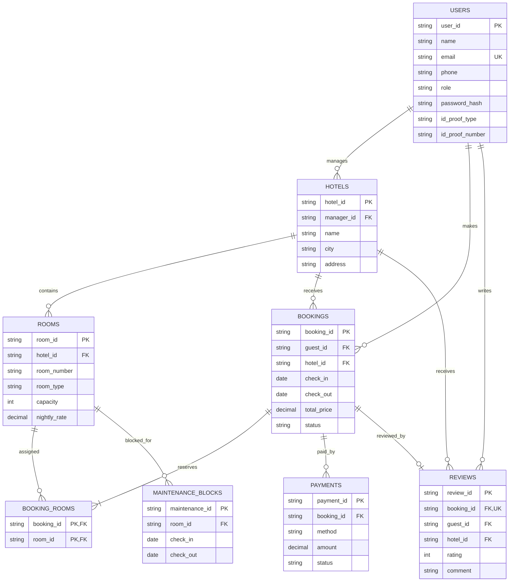

# Entity relationship diagram

The diagram models the SQL exercise schema in [schema.sql](../schema.sql). It
represents the same domain relationships as the runtime model; the application
does not connect to a relational database.

