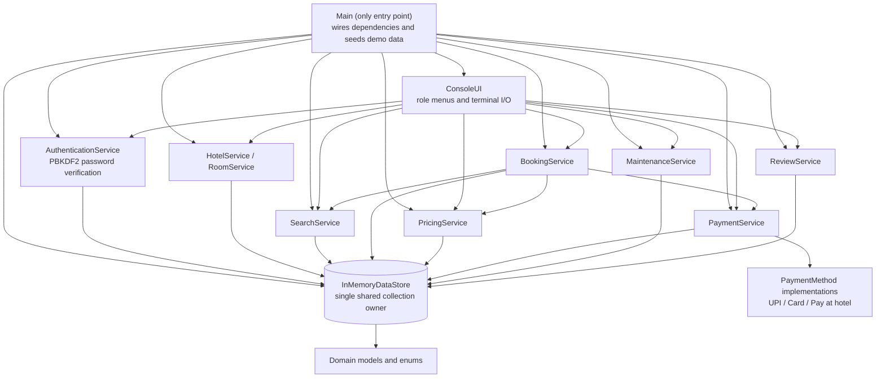

# System architecture

Services are constructed once and receive the same store instance. The UI never
owns persistence and contains no pricing, availability, refund, or lifecycle rules.
Console role routing limits visible actions; manager-specific hotel choices are
verified against ownership before mutation.
